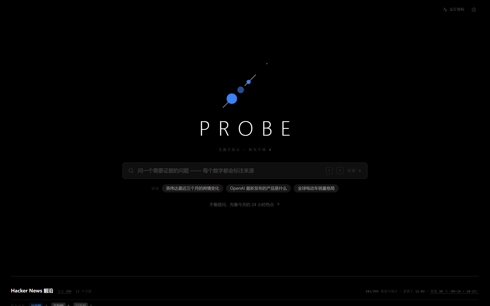
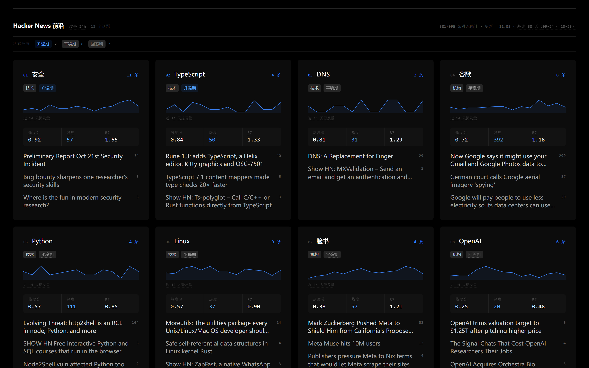
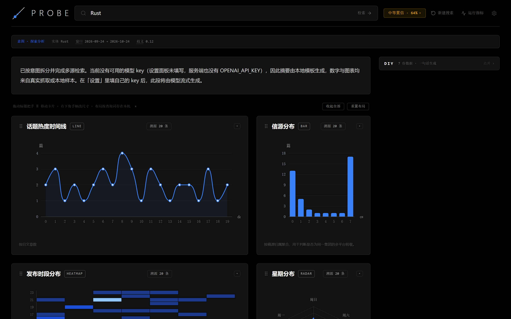
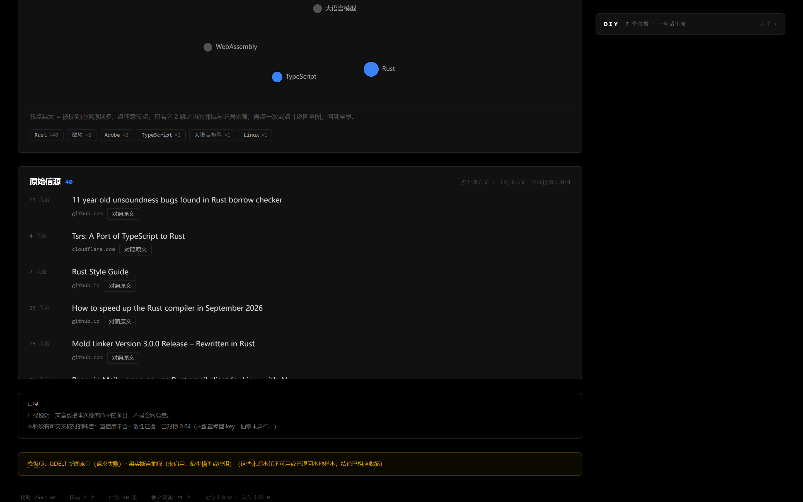
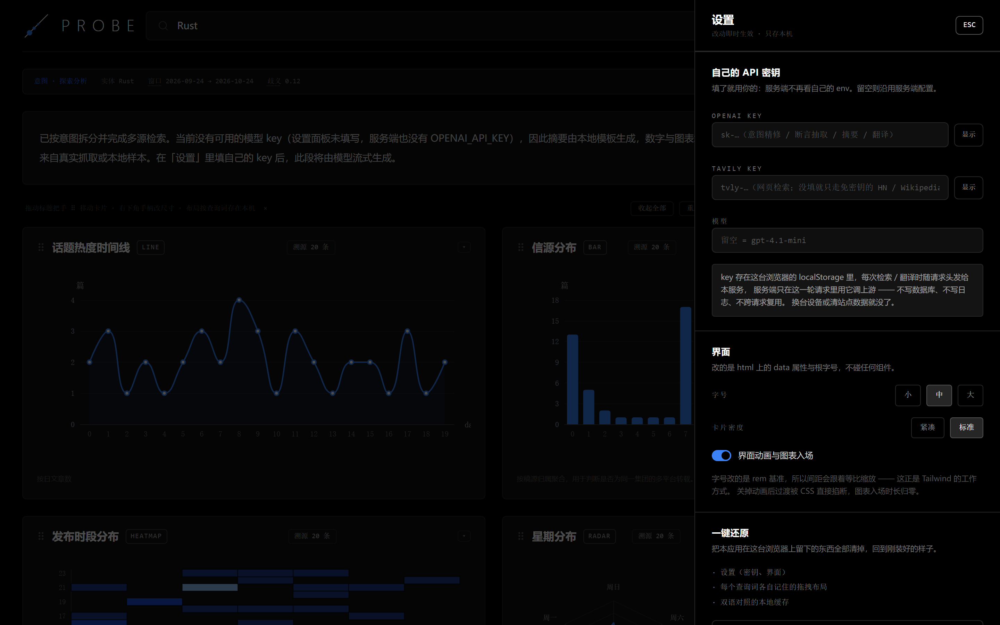

# 探针 · Probe

面向 Geek 的 AI 原生高置信度情报终端：搜索返回一个数据面板，而不是一串链接。

**差异化不是"更聪明的分析"，而是"不撒谎"**：页面上的每个数字都能点回原文，
没有来源就不显示，缺失就留空而不是填 0。默认只呈数据，追问才做分析。

---

## 界面

### 首页：一次只问一件事

超大锁标 + 一个输入行，热榜推到下一屏。理由写在「首页：入口一屏，热榜下一屏」——
一屏里堆两件事，人会先读榜、再决定问什么，产品就从「你说问题我给证据」退化成「看我们抓到了什么」。

右上角是这一页唯一的两个工具：「运行指标」与齿轮（设置）。它们用 `absolute` 钉在角上，
不参与首屏的垂直居中 —— 但**必须在首屏里**：这两个入口一个曾经藏在页脚、一个曾经只在
结果页顶栏出现，等于默认用户会先随便问一句再去找设置。「运行指标」带文字而不是纯图标，
因为一个没人认识的自定义图标比一个偏僻的链接更难找。窄屏（<640px）顶栏一行放不下四件东西，
指标入口退回结果页页脚，齿轮留在角上。



### 24 小时热点榜：排位、火花线、三格指标

排位是扫读入口，数字是细节 —— 两者不该抢字号。中间那条线是近 14 天每日提及条数，
它回答的是「这个话题平时多大」，同排的数字回答的是「今天比平时大多少」。



### 结果页：流式摘要 + 数据面板

提问之后锁标与搜索框上推成顶栏（同一个元素在移动，不是换页），摘要逐段流出，
面板按 `module.plan` 先落骨架、`module.ready` 再填内容 —— 不会盯着空白等。



### 同一页往下：图表网格、实体关系图、信源列表

图表可拖拽改位置、可一键收起（收起即卸载 ECharts 实例）。图下方的裸数字都带一句
口径说明，降级与「没测到」也如实写在同一屏里，不藏着。



### 设置：自己的 key 只留在本机

key 存 `localStorage`，随请求以 `x-probe-*` 头发给服务端，服务端不落盘。
没配也完全能用：检索与图表真实，摘要走本地模板，断言抽取关闭（不是用假数据填空）。



---

## 快速开始

```bash
npm install
cp .env.example .env.local   # 可选，不配 key 也能跑
npm run dev                  # http://localhost:3210
```

不配 `OPENAI_API_KEY` 时：检索与图表全部真实，摘要走本地模板，**断言抽取关闭**（不是用假数据填空）。

配了之后可额外得到：

| 变量 | 作用 |
| --- | --- |
| `OPENAI_API_KEY` | 意图精修、断言抽取、流式摘要 |
| `PROBE_MODEL` | 默认 `gpt-4.1-mini` |
| `TAVILY_API_KEY` | 补一路通用搜索，显著提升信源多样性 |
| `PROBE_RATE_LIMIT_PER_MIN` | 单用户每分钟检索上限，默认 3（PRD 附录 B） |

## 四个阶段

```
route    → intent（规则先行，模型精修，模型失败自动回落）
retrieve → 4 路并发检索，逐源隔离，任何一路挂掉只记 degraded
analyze  → 去重 → 置信度 → 断言抽取 → 数据集
compose  → 数据集映射成 ModuleSpec，过 compile() 白名单校验
```

前端通过 SSE 收 `intent / text.delta / module.plan / module.ready / module.error / sources / done`，
`module.plan` 先落骨架卡、`module.ready` 再换内容，所以不会盯着空白等。

## 置信度：为什么不用"多信源收敛度"

收敛度高只能证明各家的说法一致——十家媒体转载同一篇通稿即可满分，那是假共识。
这里改成三个可测量的分量：

```
score = 0.40 × 一手性 + 0.35 × 独立性 + 0.25 × 一致性
一手性 P = 1 - 转载数 / 总数
独立性 I = 1 - e^(-独立稿源数 / 3)      // 3 家 0.63，6 家 0.86，之后饱和
一致性 C = 1 - 冲突数 / 可比对数         // 无可比断言时取中性 0.5，不是 1
```

一致性按 `attr + unit` 分组：只按 attr 分组时，"营收 $3.2B" 与 "营收 3.2 million"
都会被归一成 `3.2`，三个数量级的差距被判为"完全一致"。单位不同即不同组，
组内不足两条就不参与比对。

分档 ≥0.75 高、0.50–0.75 中、<0.50 低；**低档直接抑制聚合数字与分布图**，只留原文列表。

三条硬约束写死在代码里：

1. 独立稿源 < 2 时封顶 0.45。
2. 整批都是本地演示样本时封顶 0.34，并在正文里明说"这不是实时抓取的结果"；样本不进模型，
   由代码写死的事实说明替代——只靠 prompt 叮嘱"记得说这不是实时结果"是不可靠的。
3. 没有模型时断言数为空——**不用模板编造 claim**，否则界面上会出现几句谁也没说过的"可核验断言"。
4. **一条断言都没交叉核对过（`nChecked === 0`）时封顶 0.64。**
   一致性给中性 0.5、乘 0.25 权重后，只要一手性和独立性接近满分就会越过 0.75——
   可那个分数里没有任何一条事实被两个来源对上过。独立性靠域名数量堆得动，
   一手性靠"没识别出转载"就能满分，只有一致性真正代表"核验过"。
   封 0.64 而不是 0.74：0.74 落在 medium 的上沿，看起来就像"马上要高置信"，
   而它实际上只是"我数了 40 篇文章、来自 26 个域名"。`nChecked = 0` 的原因
   （没配模型、或抽到的断言没有两条独立来源对得上）会作为一行口径说明出现在页面上。
5. **一致性按「独立来源说了什么」算，不按断言条数算。** 同一篇稿子拆出三条相同数值，
   以前能顶到 `nChecked = 3`、`conflicts = 0`、一致性满分；现在组内先按 `sourceId`
   收敛，来源数 < 2 的组直接不参与比对。
6. **同一属性的数值先折算数量级再比**：`3.2 billion` → 3200000000、`1.5万` → 15000。
   中文刻度与英文刻度不能混用（亿 = 1e8，billion = 1e9），否则「3.2 亿」与
   「3.2 billion」会被当成同一个数。

`ownerOf` 的口径必须全链路一致（`confidence.ts` 与 `analyze.ts` 同源），
否则 KPI 的"独立信源"数和信源分布柱的分组数会对不上。二级公共后缀要单独成表，
`bbc.co.uk` / `ft.co.uk` 若按 `slice(-2)` 切成 `co.uk`，十几家无关英国媒体会被并成一个稿源。

## 时间窗必须真过滤

用户的"最近三个月"是显式约束。每个 provider 都在服务端带窗口参数
（GDELT `startdatetime`、HN Algolia `numericFilters=created_at_i`、Tavily `start_date`），
返回后本地再兜一层。宁可结果稀疏，也不拿六年前的旧闻凑数量。

## 热点榜：一个只能搜索的产品没有回访理由

无 query 时首屏给热榜，数据来自 Hacker News 近 24 小时的 story 聚合（`src/lib/trending.ts`）：

- 抓过去 24 小时全部 story（实测约 994 条），只保留 `points >= 2` 的 553 条。
  另外 442 条 points 为 0 —— 全是刚发布、无人评分的，把它们算进"提及数"等于让冷门词冒充热点。
- 按词边界匹配实体词典，同一个话题被 **两条以上** 提到才上榜（一条不足以叫热点，只能叫新闻）。
- **名次按热度分（score）排，既不按条数也不按 points 之和**：条数说不出「今天是不是异常、
  还新不新鲜」，points 之和对单篇爆款过敏（三条 TLS 稿 1068 分盖过十三家在提的实体）。
  热度分怎么算、状态标签怎么来，见下一节。
- 同一话题内按 **URL 去重**：HN 上同一篇稿子被重复提交是常态（多条 story、不同 objectID、
  外链一模一样）。不收敛的后果是列表里同一链接出现两次（React 列表 key 冲突）加上
  「N 条在提」把同一篇稿子数两遍 —— 那是提交次数，不是报道数。去重保留 points 最高的那条，
  去重后不足两条的话题不上榜。
- 缓存 10 分钟；话题名与检索词分开（展示 `人工智能`，检索 `artificial intelligence`），
  否则中文话题丢进英文索引必然 0 命中。

榜单标题写死「Hacker News 前沿」而不是「实时热点」：GDELT 缺席时这里只有单一来源，
「多少家媒体在报」这个维度并不存在，写成全网热度就是编。

### 卡片：先看形状，再看数字

原来的卡片是「标题 + 一排逗号分隔的数字 + 三条带下划线的新闻」，读起来像后台日志。
一屏 12 张这样的卡，信息密度不低，但没有一处告诉你**该先看什么**。重排成四层：

1. **排位 + 名称 + 条数**同一行。序号 `01`~`12` 用 10px 等宽，前三名才是蓝的 ——
   名次是扫读入口，不该和指标抢字号；条数去掉了边框，只用 11px 蓝等宽数字。
2. **标签行去边框**：`技术` / `升温期` 都是 `rounded-sm` 的纯色块（`bg-neutral-800`）。
   原来每个标签都套一圈灰实线，一排放三四个就像一组禁用按钮。蓝色只留给「升温 / 爆发」
   这两个真趋势（`bg-blue-500/10 text-blue-400`），平稳、回落一律中性灰。
3. **指标组是一个浅底框的三格表**，不是一行字。标签 9px 大写灰色在上、值 14px 等宽白字在下，
   格与格用 `divide-x` 分隔。`热度分 0.88 热度 53 r7 1.55` 连成一串时人是不会读的 ——
   它们量纲不同、含义不同，唯一共同点是都属于这个话题。
4. **新闻列表去线化**：删掉每条下面的 `border-b`，改用 `gap-3` 控制间距；标题 14px
   `text-neutral-300`，hover 转纯白；分数退到右侧 10px 灰等宽。横线本来是在说「这是表格」，
   而这里是一组并列的条目，靠留白分组比靠线更安静。

卡片本身用 `bg-[#0c0c0c]` + 透明边框，hover 才亮成 `neutral-700`：让 12 张卡先融成一片背景，
鼠标停在哪儿才浮出哪儿。

火花线（近 14 天每日提及量）用**内联 SVG polyline**，没有上 ECharts：首页 12 张卡各起一个
canvas + zrender 实例，为了一条 14 个点的折线不值得。`preserveAspectRatio="none"` 让线随卡片
宽度拉伸，所以描边必须 `vector-effect: non-scaling-stroke`，否则窄卡上线条会变粗。

顺带修了一个连带缺陷：`kindOf` 原来按 `length < 5` 判 "需要澄清"，于是 `英伟达`、`人工智能`、
`Rust` 这类主体明确的短查询全被判死，热榜点进来每一张卡都会撞墙。含糊不等于短 ——
现在只拦真正的寒暄（`你好` / `hi` / `test`）。

## 热度公式与状态标签：名次按「比自己平时异常多少」排

只排名次的热榜有个死结：一个常年被提 80 条的话题永远压在今天突然冒到 30 条的话题上面，
那就不是热榜，是活跃度榜。PRD 2.3 要的是「今天相对它自己平时是否异常」，所以先攒基线。

```
r7    = 近 7 日均值 / 前 30 日均值            // 1.0 = 和平时一样
score = (0.6·pct(log1p(今日条数)) + 0.4·pct(z-score)) × exp(-最近一条至今小时数 / 36)
```

两项先各自按 30 天日序列取**经验分位**、变成同一量纲再加权 —— PRD 原式 `Mag + Dev × decay`
把无上界的文章量和 0~3 量级的 z 值直接相加，量纲不同，而且衰减只作用在 Dev 上，
等于量级永不衰减，历史热点会永久霸榜。

| 状态 | 判据 | 含义 |
| --- | --- | --- |
| 爆发期 | r7 > 2 且 今日条数 ≥ 历史 P95 | 今天确实异常 |
| 升温期 | r7 > 1.3 | 正在往上，还没到爆发 |
| 平稳期 | 0.8 ≤ r7 ≤ 1.3 | 常态 |
| 回落期 | r7 < 0.8 | 比平时冷 |
| 长尾期 | 历史爆发过 且 r7 ∈ [1,2] 且 连续 ≥5 天 | 「事情过去了但还在被讨论」 |

顺序即优先级：**长尾必须最先判**，否则一个刚回落的爆发话题会被「升温」吃掉，
而它恰恰是最需要被读成「余波」的那种。序列不足 14 天一律不出标签 ——
两周不到算不出「平时是什么样」，硬给一个就是这个项目最不该做的事。

基线怎么攒（`src/lib/heat-history.ts`）：

- **日界用 UTC**，不跟浏览器时区走。混用两套日界会让「昨天」变成 32 或 16 小时，r7 会莫名跳动。
- **窗口 12 小时**。实测 12h 内最多约 850 条 story，压在 Algolia 单页 1000 条以内；
  再宽就被截断，而偏小的基线会把普通一天误判成爆发。命中数贴近 1000 时还会对半再拆一次。
- **落盘到 `.cache/hn-history.json`**（临时文件 + rename 原子替换）：首次要跑 60 次请求，
  进程重启不该重来。首页调用 `ensureHistory()` **不等**构建 —— 返回 `pending` 并把构建丢到后台，
  基线好了下一分钟自己就带标签；基线未就绪时那份快照只缓存 1 分钟（正常是 10 分钟），
  否则第一次访问会把「没有标签」的榜单钉住十分钟。

这里踩到一个口径 bug，值得记下来：基线最初只滤 `title.length < 8`，而实时快照还要求
`points >= 2` 并按 URL 去重 —— 宽口径的每日计数比实时口径大近一倍（人工智能从 97.3 条/天
变成 138~170 条/天），r7 被系统性压低，每个话题都像在回落。现在两处共用同一个 `MIN_POINTS`，
`HISTORY_VERSION` 升到 2 让旧缓存自动作废 —— 不升版本，旧宽口径数据会一直生效。

实测：30 天 / 60 个 12h 窗口 / 并发 4，**19.2 秒**建完；首页 12 个话题拿到
`升温 2 / 平稳 7 / 回落 3`；五档判据用构造序列单测过一遍（含长尾：21 天 10 条、2 天 60 条、
近 7 天 20 条 → r7 1.28、hotDays 7、wasBurst true → 长尾期）。
## 拖拽布局：快照为什么先落在本机

Phase 2 的验收是「拖拽保存刷新仍在」。PRD 写的是 Supabase，但那个 key 至今空着——
没有鉴权、没有表结构，写进去只能先造一张谁都能读的表。所以这一版把快照存在
`localStorage`，键是 `probe:layout:<layoutVersion>:<query>`，**结构仍按 PRD**：

```
{ schemaVersion, layoutVersion, query, savedAt, items: [{ i, x, y, w, h }] }
```

换存储层只改 `src/lib/layout.ts` 的读写，形状不变；界面文案如实写着"按查询词存在本机"。

几个不显眼但会咬人的点：

- **流式期间锁拖拽**，不是靠 CSS 假装。`module.plan` 一路到达就重排一次，
  用户在拖到一半的卡片会跳走；锁是真的把 `dragConfig.enabled` 关掉，且不渲染拖拽把手。
- **只在 `onDragStop` / `onResizeStop` 提交**。跟 `onLayoutChange` 提交的区别不是性能洁癖：
  每帧 setState 会重渲染整棵树，ECharts 实例跟着重建，拖起来像在拖一张图片。
- **快照不复活已消失的卡片**。`reconcile` 以本轮默认布局为准，只把能对上的 id 的位置搬过来；
  上一轮有的模块这一轮没有，就直接不出现，不硬渲染一个没有数据的空壳。
- **版本不匹配整份丢弃**并给一句中文提示，而不是逐项迁移——布局数据不值钱，
  读错的布局会让人以为卡片丢了。
- **卡片高度交给网格单元**（行高 28、间距 12），图表容器 `height:100%`：
  拖高卡片图跟着长，拖矮则保住 `min-h` 不压成一条缝。
- **窗口 < 720px 退回单列**并说明拖拽已停用。12 列在这个宽度下每列不到 40px，
  拖出来的位置没有任何意义。

## 术语解释：把"行话"摊开在鼠标下面

「一手性」「独立性」「歧义」这些词是产品的核心口径，也是用户最容易误读的地方——
把「置信度 0.74」看成「74% 正确」的人不止一个。所以每个术语都是一个可展开的
`Term`（`src/components/Glossary.tsx`，词条在 `src/lib/glossary.ts`）：

- **三通道打开**：hover（鼠标）、focus（Tab 到）、点击（触屏）。只做 hover 等于
  把触屏和平板用户挡在外面。
- **不用原生 `title`**：原生提示延迟一秒、不可选中、不能换行，塞不下"公式 + 口径 + 已知盲点"三段。
- **弹层用 `createPortal` 挂到 `document.body`，`position: fixed`**。挂在触发词里面会被
  卡片的 `overflow: hidden` 裁掉；网格卡片还带 `transform`，而 `transform` 会把
  `position: fixed` 的包含块从视口改成卡片本身——气泡于是又飞出去、又被裁。挂到 body 才同时躲开这两条。
- **位置是量出来的，不是按 align 猜的**：`getBoundingClientRect()` 取锚点、`offsetWidth/offsetHeight`
  取气泡，先按 `align` 算出一侧，再夹进 `[8, 视口宽 − 8 − 气泡宽]`；下方放不下翻到上方，
  上方也放不下就贴底。缩放、滚动时跟着重算，锚点滚出视口直接关掉。
  只按 `align` 选左右等于赌「这个词永远不在屏幕边上」——页头右侧的置信度徽章专门证伪这一点。
- **从触发词移进气泡不会关**：140ms 延迟关闭 + 气泡自己 `onMouseEnter` 取消。
  否则鼠标一离开词条气泡就消失，"公式 + 口径 + 盲点"三段文案根本读不完。
- `role="tooltip"` + 内层 `aria-label`，Escape 与点外部关闭。
- 词条正文写清**它不是什么**（"置信度是证据强度，不是正确概率"），比只写定义有用。

## 双语对照：颜色标的是"可核对的差异"，不是翻译质量

点任一条信源的「对照原文」，服务端抓正文、分段、翻译，逐段左边原文右边译文
（`src/lib/translate.ts` + `src/components/BilingualCompare.tsx`）。

**歧义度由机械比对算出来，不问模型。** 让模型给自己的译文打分歧分，它永远给 0.9——
那是自评，不是证据。实际用的是可核对、可复现的五类信号：

| 信号 | 触发条件 |
| --- | --- |
| 数字丢失 | 原文里的数字在译文里找不到（正则排除 `Q3` / `H200` 这类编号里的数字） |
| 专名未保留 | 公司/产品/人名被意译掉，读者搜不到原始出处 |
| 未译残留 | 译文里还留着成串英文（单句首大写词如 `Rust` 不算——那本来就该保留） |
| 篇幅比例异常 | 英译中落在 0.22–1.05 之外，通常意味着漏译或自我发挥 |
| 原文本身含糊 | may / could / 据称 / 消息源模糊 —— 翻得再准，读者也会读成确定结论 |

`risk = 1 - Π(1 - w)`，分档 <0.30 低（青）、<0.60 中（琥珀）、否则高（玫红）。
图例里写死了"不是质量评分"：青色只代表数字和专名都对得上，不代表这段话可信。

几条必须守住的边界：

- **内网地址不抓**——这个接口是「让服务器替我访问任意 URL」，不收口就是 SSRF 跳板。
  判据不是域名字符串，而是**解析出来的 IP**：`hostAllowed()` 用 `dns.lookup` 拿到全部 A/AAAA
  地址，任一落在私网段（含 `169.254.169.254` 这类云元数据）就拒。原因是按域名启发式守不住：
  `127.0.0.1.nip.io`、`localhost.`、`[::ffff:127.0.0.1]` 都不像内网，但都指向本机。
  更关键的是这道闸门在 `getDirect()` 入口，而每一跳重定向都递归回 `getDirect()` ——
  `http://X/` 302 到 `http://169.254.169.254/…` 会在第二跳被拦，而不是只看首跳。
  畸形 `Location`（`//`、坏 IPv6 括号）返回 `invalid_redirect`，不会把请求挂死成 500。
- **抓不到正文就退回标题与片段**，并在面板里写明"只对照了标题与片段"，
  而不是默默拿标题当全文翻。
- **原文本来就是中文时不翻**（`targetFor` 恒为 `zh`）：把中文报告"翻译"成英文
  对读中文的人没有价值，只会多一层机器改写，于是单栏出原文、不给颜色。
- **没译成不记 0 分**：0 分在界面上等于"没问题"，而这一段恰恰最该被怀疑。
- 引擎分级写清楚：有 `OPENAI_API_KEY` 走模型，否则用 MyMemory 公共接口，
  都不行就只给原文分段。面板里永远标注**谁翻的**。
- 公共接口有每日配额，长文只翻得成前一部分（实测 41 段里翻成 20 段）：
  剩下的如实标成"未翻成，保留原文"，并在降级条里写 X/Y。

**一个非写不可的坑**：本机 `NODE_USE_ENV_PROXY=1` 时，Node 的 `fetch` 会走
`HTTPS_PROXY`，而那条链路对 `api.mymemory.translated.net` 会 `ECONNRESET`
（实测 6/6 失败；同一 URL 直连 100% 成功，curl 走代理也正常）。所以抓正文与调翻译
都不走 `fetch`，改用 `node:https` 的 `getDirect`（`src/lib/http.ts`）——
它默认不读代理环境变量。附带好处是重定向、超时、字节上限都握在自己手里。

## 数据模块：不是"多画几种图"，是"多几种能算准的形状"

第二批 6 种图形全部由 `analyze()` 里真算出来的 dataset 驱动，没有一种是装饰性占位。
共同原则：**凑不出就整张图不出**——不画空图，也不补 0。

| 模块 | 形状 | 数据从哪来 | 出不来的时候 |
| --- | --- | --- | --- |
| `m-hours` | heatmap 星期×小时 | `hourParts()` 拆 `publishedAt`（Asia/Hong_Kong；`hour12:false` 下午夜给 24，要再 `%24`） | 只有 1 个格子时不出 |
| `m-weekday` | radar 7 维 | 同一份解析结果按星期计数 | 有数据不满 3 个星期时不出（三维以下没有形状可言） |
| `m-terms` | graph 共现网络 | `titleTerms()` 抽标题里的专名，两两共现计数 | 高频专名 <4 个或边 <3 条时不出：几根散线不叫网络 |
| `m-flow` | funnel 检索收敛 | 命中条目 → 去重后 → 有发布时间 → 24h 内 | 一条都没有发布时间时整张不出 |
| `m-fresh` | gauge 24h 新鲜度 | `fresh / dated` | 同上 |
| `m-tone-scatter` | scatter 时距×情感 | GDELT 的 tone 与距今天数（0–7 天） | 不足 3 个点、或本轮没有 tone 时不出 |

漏斗那四级是刻意选的：`fresh ⊆ dated ⊆ sources ⊆ raw` 是集合包含关系，
所以这张图**不可能自相矛盾**。断言数没有放进来——claim 可以来自没有发布时间的条目，
放进去会破坏包含关系，画出来就会出现"后一级比前一级多"。

`compile.ts` 的字段校验这批改成了**全量**：以前只查 x/y/value/series 四个键，
graph 的 `from/to` 与 funnel 的 `stage` 正好绕过去，字段写错的结果是一块空白而不是报错。
现在 encode 里任何值不在 fields 中就直接降级成表格，并在卡片上写原因。

## 视觉：一套颜色，三个意思

层级只靠两件事：**底色差**与**边框亮度**。页面是纯黑 `#000`（不是近黑 `#0a0a0a`——Logo 的节点蓝
`#0055FF` 压在近黑上只有 3.5:1，会「陷」进底色，退到纯黑才站得住）、卡片 `#111`、边框 `#262626`、hover
`#404040`、圆角 6px。没有 `backdrop-filter`、没有发光阴影、没有渐变背景、没有扫描线——
这些在意式咖啡上很好看，在数据终端里每一个都在跟数字抢注意力。

颜色只有三个意思，多一个都要解释：

| 颜色 | 含义 | 出现位置 |
| --- | --- | --- |
| 蓝 `#3b82f6` | 强调 / 可操作 / 正常 | 主按钮、链接 hover、焦点环、图表主色、置信度 high |
| 黄 `#eab308` | 降级 / 需要留意 | 检索降级条、疑似转载、置信度 medium、布局没存下、翻译歧义 mid |
| 红 `#ef4444` | 出错 / 高危 | 查询失败、图表编译错误、置信度 low、翻译歧义 high |

其余一律灰阶。**同一套语义用到三处**：置信度三档（high 蓝 / medium 黄 / low 红）、双语对照的
歧义度（low 蓝 / mid 黄 / high 红）、请求状态（降级黄 / 失败红）——不另造第四种编码，
用户学一次就够用三处。

数字必须能竖着比：所有指标、ID、时间都是 `font-mono` + `tabular-nums`（等宽数字），
不然列表里 `1` 和 `7` 宽度不同，上下两行的小数点就对不齐。正文用 Inter。

以前有三套主题（青 / 紫 / 琥珀），靠覆盖 Tailwind 的 `--color-cyan-*` 变量换色。现在连
`THEMES` 常量、`data-theme`、`data-fx` 一起删了：一套配色只要说清「这个颜色什么意思」，
三套就得说清三遍，而第二遍开始就没人看说明了。图表色板也收成一个蓝的明度阶梯 + 一个中性灰
（`compile.ts` 的 `PALETTE`）——颜色在图表里不该用来「好看」，只该用来区分。

品牌只有一处：`src/components/ProbeLogo.tsx`（白轴线 + 三个蓝节点，`vectorEffect="non-scaling-stroke"`
保证放大缩小时描边不跟着变粗），favicon `src/app/icon.svg` 用同一套语言重画。节点色就是强调色
`#3b82f6`（纯黑上 5.7:1）；品牌蓝原先用更深的 `#0055FF`，在纯黑上只有 3.7:1，蓝点会陷进背景。

验收方式是扫 DOM 而不是看截图：全站 `backdrop-filter !== none` 的元素 0 个、`box-shadow !== none`
0 个、旧色值（青/琥珀/玫红）0 处；`.panel` 的 computed 值依次为 `rgb(17,17,17)` / `rgb(38,38,38)` /
`6px` / `layout style`，hover 后边框 `rgb(64,64,64)`。
## 设置：自己的 key、外观、一键还原

三件事共用一个面板，全部只在本机：

| | 存在哪 | 走哪条路 |
| --- | --- | --- |
| OpenAI / Tavily key、模型名 | `localStorage` 的 `probe:settings:v1` | 每个请求带 `x-probe-openai-key` / `x-probe-tavily-key` / `x-probe-model` |
| 字号、密度、动画 | 同上 | 写到 `<html>` 的 `data-density` / `data-anim`，字号直接改根 `font-size` |
| 布局快照 | `probe:layout:*` | 见上一章 |

key 走请求头而不是查询串：查询串会进服务端访问日志，也会留在浏览器历史里。
服务端用 `AsyncLocalStorage` 把它绑在**本次请求**的调用链上（`src/lib/runtime-config.ts`），
`llmEnabled()` / `resolvedModelId()` / `resolvedTavilyKey()` 都是"先读这次请求的、再回落 env"。
这样不用给每个函数加参数，也不会串到下一个请求里：**不落库、不写日志、不跨请求复用**。

填了错的 key 会怎样：`llmEnabled()` 变 true，模型调用失败，摘要一句都写不出来。
这种情况会在摘要区明说"摘要没有生成"，而不是留一片空白让人以为数据不全——
面板里的数字与信源不依赖模型，照常可读。

这里没有「主题切换」，只有一套配色。之前的青/紫/琥珀三套皮肤连 `THEMES` 常量一起删掉了：
一套界面配色要能说清「这个颜色是什么意思」，三套就得说清三遍。图表色板同理，写在
`compile.ts` 的 `PALETTE` 里，是蓝的明度阶梯加一个中性灰——canvas 读不到 CSS 变量，
所以这一份必须和界面手对齐。

字号改的是根字号（15/16/17px）：Tailwind 的间距与字号都是 rem，改根字号等于整站等比缩放。
密度改的是网格间距（紧凑 16 / 标准 24），不是给卡片加一层更小的 padding——
后者会让图表在窄卡里挤成一团。

"一键还原"清掉所有 `probe:` 前缀的本机键（设置 + 每个查询词的布局快照），然后整页重载。
按钮要按两次，第二次 4 秒内有效：这个操作没有撤销。

## 性能：帧率按「最长的那一帧」算，不按平均值

平均值骗人。240Hz 屏上一秒 240 帧，只要有 3 帧掉了 60ms，手感就是「卡一下」，而平均帧率仍然是 230fps。所以这里的验收口径是 **LoAF（long-animation-frame）**：浏览器原生告诉你「这一帧超过 50ms 了吗、渲染开始得多晚、里面脚本占多少」。

测量方式（`PerformanceObserver({ type: "long-animation-frame" })` + rAF 帧间隔采样），1440×1000、`next start` 生产构建、每档跑 3 次看区间：

| 场景 | 改前 最长帧 (ms) | 改后 最长帧 (ms) | 说明 |
| --- | --- | --- | --- |
| 流式输出期间 | 413 / 262 / 229 | 246 / 229 / 213 | 中位 262 → 229（−13%）。**单次测量本身就能差 ±80ms**，所以只敢说中位，不敢说峰值 |
| 流式 jank 帧（>33.4ms） | 5 / 6 / 6 | 5 / 5 / 6 | 每 2000 帧里 5 帧，0.3%，没变 |
| 空闲 | 8.3 / **62.5** / 4.4 | 8.4 / **62.3** / 8.4 | 那 62ms 是偶发的，改前改后都会撞上一次 |
| 滚动 | 16.7 / 8.4 / 12.6 | 8.4 / 8.3 / 8.5 | 三次都一样：首次滚动不再掉一帧 |
| 拖拽 | 50.1 / 45.9 / 66.6 | 45.8 / 74.7 / 62.4 | **没有实质改善**，见下 |

真正稳定的改善是**滚动**：三次测量全部 8.3–8.5ms（= 120Hz 的一帧，本机屏 240Hz 所以是四分之一帧），改前有一半的跑法会掉到 12–17ms。空闲与拖拽的帧率都在 200fps 以上。拖拽没变好：`react-grid-layout` 拖动时是 transform 位移，本来就该是合成层的事，但每次松手前它都要测一遍所有卡片的占位——这段成本它的 API 不给钩子，我们改不动。

流式那 5 个 jank 帧也别指望消掉：那是 8.6 秒里 SSE 事件把三张卡依次塞进网格造成的，属于「内容真的变多了」，不是渲染浪费。

### 具体做了什么

1. **流式合帧**（`src/hooks/useProbe.ts`）：原来每个 `text.delta` 都 `setState`，摘要每多一个字，整棵树（四张卡、两张图）就重渲染一次。现在攒进 ref、按 `requestAnimationFrame` 一帧只刷一次，并且遇到 `module.ready` / `done` 这类结构事件先强制 flush，保证顺序不乱。
2. **ECharts 动画 1000ms → 240ms**（`src/lib/compile.ts`）：默认入场动画会在这 1 秒里每帧重绘 canvas；情报工具不需要「图表长出来」的仪式感。
3. **`backdrop-filter` 的旧账**（`src/app/globals.css` 的 `.panel`）：旧皮肤上十几张卡各带一层 `blur(24px)`，我们做过 A/B（首页 12 张卡，运行时注入/撤掉 blur）——**去掉 blur 滚动 231fps、最长帧 8.4ms；带着 blur 234fps、最长帧还是 8.4ms**，4 倍降频下也一样；只测流式段（带 blur 112.3–112.6ms vs 去掉 104–108ms）差 4–8ms，落在噪声里。所以它当年不算性能问题。现在整套 `backdrop-filter` 随新设计一起删了：**干净不是为了省帧，省帧只是顺带**。留着的是 `contain: layout style`——卡片内部布局不外溢，拖拽时少一次全局布局计算。
4. **hover 只改边框颜色**：旧版是让 `box-shadow` 从无过渡到一片大范围模糊阴影，指针扫过一排卡片时每张都要重新光栅化（后来改成常驻层切 `opacity`）。新版干脆不用阴影——hover 只把 1px 边框从 `#262626` 提到 `#404040`，`transition` 只有 `border-color 160ms`，颜色插值不新建任何绘制层。
5. **背景只剩一个颜色**：`body` 上只有 `background-color: #000`。中间那一版把辉光、扫描线、64px 网格铺在两个 `fixed` 伪元素上（滚动只移动内容层，确实是优化），但新设计里这三层一个都不该存在——**最省的重绘是不画**。
6. **`ResizeObserver` 让 canvas 跟着卡片走**（`ModuleCard` 里的 `ChartBox`）：ECharts 只知道窗口尺寸，不知道卡片被拖大了——原来把卡从 4×8 拖到 6×11，图会被拉花。现在按帧去抖后 `resize()`。
7. **拖拽期间降级**（`ModuleGrid` 在 `<body>` 上挂 `.grid-interacting`）：拖起来的那张卡与邻居本来都要重画，期间把 `.panel` 的 `border-color` 过渡关掉，只搬动已光栅化的图层，松手恢复。
8. **`memo` 挡在网格外**（`ModuleGrid` / `ModuleCard` / `SourceList`）：流式期间摘要每帧变，但 `modules` / `sources` 的引用没变，网格不必跟着重跑 `react-grid-layout` 的布局计算。
9. **尊重 `prefers-reduced-motion`**：关掉光标闪烁与骨架流动。这不是性能，是礼貌。

### 一个必须说清的坑

`npm run dev` 下的数字**不能**用来判断渲染性能。Turbopack 的按需编译、React 开发版的双次渲染，都会在首次交互时塞进几百毫秒的长任务；同一个页面在 `next start` 下这些数字会凭空少一半。要复现上表，先 `npm run build` 再 `npm start`，且不要和 `next dev` 同时跑（两者共用 `.next`）。

## 交互：结果先出来，工具按需出现

这一版的交互原则来自 Nielsen Norman Group 的三条经典结论，不是凭手感调的：

- **渐进披露（Progressive Disclosure, Nielsen 2006）**：先只露最重要的选项，专业选项按需请求
  才出现（原文举的例子就是打印对话框）。→ 生成器不进主视图，收在侧栏入口背后，**只在结果
  跑完之后才出现**，检索过程中连占位都没有。
- **模态 vs 非模态（Modal & Nonmodal Dialogs, Fessenden 2017）**：模态会打断并强制一个动作，
  只在必须把注意力导向重要信息时才用。→ 生成器是**非模态浮层**（portal + fixed）：不锁滚动、
  不遮背景、点外面就收。为了一个可选动作拦下整页，成本远大于收益。
- **10 Usability Heuristics**：#1 系统状态可见（跑完才给工具，跑的时候只说"正在检索"）、
  #2 贴近真实世界（入口文案是"说想看什么"，不是 `ModuleSpec`）、#7 灵活高效（`/` 一键聚焦
  搜索框）、#8 极简（操作提示只留一次，之后可关）。

落成七件小事：

1. **DIY 只在结果页**：`Workspace` 用 `state.status === "done" && datasets.length > 0` 门控侧栏，
   不满足时整列都不渲染，同时把 `xl` 的两列栅格收成一列，不留 340px 空槽。
2. **侧栏只有一个键**：DIY（38px 高的一行，左边字标、右边「N 份数据 · 一句话生成」）。
   原来是一张 64px 圆钮 + 三行说明的大卡 —— 侧栏是工具区不是引导页，常驻的大卡会一直
   和结果抢注意力。一句话生成是 DIY 的下级内容，点开浮层才看到。`aria-expanded` 跟着变。
3. **生成后带路**：「去看看 →」滚到新卡并给 1.4s 的 `.card-flash` 高亮，而不是弹 toast。
4. **提示可关**：网格顶部那行操作说明点 `×` 收起，写进 `probe:grid-hint:v1`（`probe:` 前缀会被
   设置面板的「一键还原」一起清掉）。
5. **`/` 聚焦搜索框**：GitHub / Linear 那套。只在焦点不在输入框里时抢——正在别处打字不动它。
6. **浮层定位只剩一份算术**：`src/lib/placement.ts` 的 `placeFloating()` 被术语气泡与 DIY 面板共用
   （贴边夹回视口、下方放不下翻上方、贴底兜底），`anchorVisible()` 负责"锚点滚走就收起"。
7. **`prefers-reduced-motion` 与设置里的「动画」开关**同时作用于新增的 `.rise` 与 `.card-flash`。
8. **「收起全部」只收看不收存**：收起把每张卡压到 2 行高（80px），卡片的 body 整个不挂载 ——
   ECharts 实例跟着卸载，收起才真的省下渲染。布局里始终保留展开时的真实 `h`，所以展开原样
   复原、快照也不会被收起状态污染（下次打开仍是展开的）。拖拽落盘前要把收起中的卡的高
   换回原值，否则一次拖动就会把 80px 写进快照。实体关系图不在网格里，靠 `onCollapseAll`
   这个信号同步收起 —— 一排标题栏中间留一张还亮着的图，像没听指令。

## 首页：入口一屏，热榜下一屏

没有 query 时不再是「工作台 + 侧边热榜」的同屏布局，而是搜索引擎式的封面：

- **一屏只放一件事**：竖排锁标（`size` 用 `clamp(30px, 4vw, 56px)`，1440 下图形 162px）居中，正下方是 720px 宽的
  搜索框，再往下才是「不看提问，先看今天的 24 小时热点 ↓」。热榜放进同一页的 `#trending`
  区块（`min-h-[calc(100svh-5.5rem)]` 把 hero 撑满首屏），一屏之下，不是另一个路由 ——
  另开路由会让「点进去看看」多一次跳转和一次返回，而这里的热榜本来就是同一份数据。
- **为什么不把热榜并排放**：同屏时眼睛先落在榜首，用户会先读榜再决定问什么。产品的第一句
  话应该是「你说问题，我给证据」，而不是「看我们抓到了什么」。热榜是留客的入口，不是主页。
- **发起检索就换布局**：`state.status !== "idle"` 时切回小锁标 header + 搜索行 + 结果。
  手里有结果的人不需要再看巨大的 Logo；把首页那套排版留在结果页只会挤掉数据。
- **回得去**：结果页的锁标本身就是「回到首页」按钮，右侧另有 `新建搜索`（清空输入、
  中止流、去掉 `?q=`、滚回顶部）。两者都不刷新页面 —— 状态归零靠 React，不靠一次重载。
- **入场先画线，再落点**：轴线用 `stroke-dasharray/dashoffset` 从 45.3 画到 0（880ms），三个节点
  按 240 / 380 / 500ms 依次缩放落位；中间那颗原本就靠 `animate-pulse` 呼吸，入场动画会顶掉它，
  所以把「落位 + 呼吸」两段叠在同一条 `animation` 里。只在封面用（`.logo-in`）——Header 里
  的小锁标每次导航都重演一遍就是骚扰。**关动效时必须显式给终态**：`prefers-reduced-motion`
  下若只是 `animation: none`，元素会停在 `dashoffset: 45.3` / `opacity: 0` 的初始样式上，
  画面里什么都没有。

实测（prod，1440×1000）：锁标 svg `162×162` 在 `x=639`（画布中线 (1440−162)/2），搜索框
`720×49` 在 `(360, 528)`，`#trending` 顶端落在首屏之下；390×844 下锁标居中、搜索框铺满
`350`、热榜顶端 `912` 仍在下一屏。点热榜话题后 7 个模块正常出图，console 零 error / 零 warning。

### 从封面到结果页：是同一个元素在移动，不是两个页面在切换

回车之后没有跳转、没有重载、也没有两套 DOM 互相淡入淡出。锁标和输入行是**同一批元素**，
`className` 换了、位置和尺寸由 framer-motion 的 `layout` 插值：

```tsx
<motion.div layout transition={SPRING}            /* 容器：竖排居中 ⇄ 顶部一行 */
  className={searched ? "flex flex-wrap items-center gap-x-4 border-b … py-4"
                      : "flex min-h-[calc(100svh-5.5rem)] flex-col items-center justify-center gap-7"}>
  <motion.div layout transition={SPRING} …>        /* 锁标 162px 竖排 → 41px 横排 */
  <motion.div layout transition={SPRING} …>        /* 输入行 720px 居中 → flex-1 顶栏 */
```

- **为什么不是两个组件**：两套 DOM 各自动画时，中间那 300ms 会出现两个锁标、两个输入框
  （一个在飞、一个在原位等），而且输入框换实例会丢焦点、丢已输入的内容。元素只有一个，
  状态也只有一个（`state.status !== "idle"` 就是 `isSearched`，不再另存一个布尔，
  否则两处各记一次必然漂移）。
- **只给容器和两个子元素 `layout`**：容器管换行与 padding，子元素管自己的宽高。
  `SPRING = { stiffness: 260, damping: 30, mass: 0.9 }` 落在 ~480ms 收住 ——
  再软就慢得像加载，再硬就是瞬移。
- **卡片另走一条**：网格项外层是 react-grid-layout 的定位盒，在它上面做 `transform`
  会和拖拽位移打架。所以入场只动内层 `<motion.section>`（`opacity 0→1`、`y 20→0`，
  0.4s ease-out）。落定后实测 `transform: none`、`opacity: 1`，拖拽与快照写入照旧。
- **顶栏在窄屏会换行**：输入行有 `basis-[240px]`，放不下就整行落下（390 宽时 header 变成
  三行 171px 高：锁标 / 输入行铺满 350 / 工具 242），`scrollWidth` 仍是 390。
  首页示例 chip 只在 `size="lg"` 出现 —— 顶栏那一行是常驻控件，摆一排快捷词会把行高撑到 185px。
- **顺带修掉一个窄屏旧 bug**：`ChartBox` 的画布原来是 `height: 100%`，要求父元素有确定高度；
  网格里卡片高度是定值所以看不出来，窄屏退回单列后卡片是 `auto`，100% 解析成 auto →
  ECharts 量到 0，报 `Can't get DOM width or height`，然后按 100px 画、底下空一截。
  改成容器 `relative` + 画布 `position: absolute; inset: 0`，实测移动端 canvas 从 `308×100`
  变成 `308×180`，那条 warning 消失。

过渡实测（1440，每 ~53ms 采一次几何）：锁标宽 `162 → 67 → 51 → 44 → 42 → 41`、`y 220 → 33`，
输入行宽 `720 → 836 → 993 → 1047 → 1064`、`y 528 → 210`，~480ms 收住；结果页 header 高 `75`，
搜索框 `940` 宽，工具组（置信度徽章 + 新建搜索 + 齿轮）靠右到 `x=1166`。点「新建搜索」后
锁标回到 `162 @ (639, 220)`、地址栏的 `?q=` 被清掉、热榜回到下一页。

### 收紧视觉中心：一台入口不需要五个边框

首屏原来有五个各自带边框的元素（锁标、副标题、输入行、两个 kbd、三个 chip、一个按钮），
每个边框都在喊「我也是一块」。收紧后只剩输入行一条线：

- **锁标图形与 PROBE 的间距**从 `0.85em` 收到 `0.3em`（56px 字号下 17px）。间距一旦大于字距，
  读起来就是「一个图标 + 一行字」，不像一个锁标。
- **输入行压扁**：`py-4` → `py-3`，行高 66 → **49px**；放大镜换成常规形状、描边 `1.25`
  （再细一档在 2x 屏上发虚）；右侧「检索 →」改成幽灵按钮，无底色，hover 只把字提到纯白。
- **示例 chip 去边框**：`rounded-full bg-neutral-900 text-neutral-400`，hover 提亮到白。
  原来三个灰边框胶囊排在一起像禁用按钮。
- **设置入口只留齿轮**：`button` 变成 8px padding + 15px 的 `stroke-width: 1.25` 齿轮，
  `text-neutral-600`，无边框无底色 —— 它是逃生口，不该和主行动争重量。
- **底部提示** `text-xs`，箭头 `animate-bounce`（`motion-reduce:animate-none`）。

## 一句话生成模块：句子只决定「看哪份数据、用哪种图形」

输入「用散点图看情感分布」，网格里多一张卡。这句话里的模型能决定的只有三件事：
**用哪一份数据集、画哪种图、标题叫什么**。字段怎么映射到 x / y / value 不归它管——
`compile.ts` 是安全边界，模型直出的 encode 的失败方式不是语法错，而是「语法合法、语义胡说」，
那种错没有人能一眼看出来。所以 `autoEncode()` 按字段类型硬性匹配：数值字段才配 value 轴，
时间字段优先配 x 轴，一张都匹配不上就返回 null，让调用方换图。

没有 key 的时候走 `src/lib/module-plan.ts` 的本机关键词规则，两个细节是有意的：

- `KIND_WORDS` 的**顺序**参与语义：「散点图」必须排在「图」前面，否则任何带「图」的句子都会退化成长条。
- `DS_WORDS` 给每份数据集配中文说法（信源/稿源/来源、时段/小时/几点、星期/周几/周末……），
  按 `命中词 × 3 + 数据集名字串 × 4 + 字段名 × 1` 打分。**一个都没命中时不猜**，
  直接回一份「这一轮有这些数据」的清单让人自己挑。

数据只从**这一轮已经算出来的** dataset 里挑（`datasetsFromModules` 遍历现有模块的 `spec.dataset`），
不重新检索、不碰全网。代价是自定义面板跟着这一轮走：刷新页面或换一个问题，它就没了——
这句话直接印在面板上，不让人误以为它被存下来了。

入口是侧栏里的「DIY」卡片（`src/components/ModuleDock.tsx`），面板本身开在浮层里。
**它只在 `done` 且真有数据可出图时才出现**：检索中、失败、空闲都不留占位——进度已经在左列
写着，一个还不能用的入口只是噪音（依据见上一节）。整块卡片都是按钮，点说明文字也能开，
不是只有那个圆钮能点。点开是 portal + `position: fixed`，理由和术语气泡一样（侧栏
`overflow-y-auto` 会裁、卡片 `transform` 会改 `fixed` 的包含块）。位置对齐**整块入口**而不是
圆钮：右对齐 64px 的圆钮会让 340px 的面板往左偏出侧栏、盖住结果区——面板左边缘和侧栏左边缘
重合才像"从这里展开"。下方放不下上翻、两侧都放不下夹进视口；入口滚出视口直接收起来；
Esc、点外部、再点一次都能关。

生成成功后浮层里多一个**「去看看 →」**：收起浮层、滚到新卡片、闪 1.4 秒。不弹 toast——
要说的话（"已加入网格"）面板里已经写着了，再弹一次只是打断。

侧栏从 `xl`(1280px) 起才常驻（更窄时落到结果下方）：1024–1279px 撑两列，左列会窄过
`ModuleGrid` 的 720px 底线、网格直接退回单列，那不如让它先不分栏。

画不出来时说清楚。前端先拿 `compile()` 试一遍，失败就把 `compileErrorText` 的原话贴出来
（「雷达图至少要三个维度」），**不悄悄降级成表格**——一张表能装下任何数据，但用户要的是图，
换成表格等于没回答。字段真的不合适时，规则会在**选图阶段**就换一种（「用散点图看信源分布」
只有一列数值，改条形图），并在 reason 里写「已改用条形图」。

一个坑记在这：`compile()` 对 `table` / `kpi` 返回 `unknown_kind`（它是给图表用的），
所以这两种图在插入前跳过编译，否则「用指标卡看概况」永远失败。

实测（`POST /api/module`，无 key，本机规则路径）：

| 句子 | 结果 |
| --- | --- |
| 用条形图看每天的文章数 | `bar` + `ds-timeline`，encode `{x: day, y: articles}` |
| 看发布时段 | `heatmap` + `ds-hours`，encode `{x: weekday, y: hour, value: articles}` |
| 用散点图看趋势 | 回落 `line`，reason 写「按日文章数」的字段画不出散点图 |
| 用散点图看信源分布 | 回落 `bar`，同一条路径的第二层兜底 |
| 你好 | `{ok: false, error: "no_dataset"}`，附这一轮可用数据集清单 |

路由限流 12 次/分钟（`PROBE_MODULE_RATE_LIMIT_PER_MIN`），和搜索分开计数：
本机规则是廉价调用，但走到模型路径要花钱，别让它变成无限次试用。

## 实体关系图：边是「一起出现过」，不是「有关系」

PRD 里这一项写的是 Postgres 邻接表 + pgvector 的「向量近邻 2 跳」。这个仓库没有数据库、
也没有 embedding，所以落地的是**本轮信源的共现快照**：节点是实体，边是两个名字在
同一条标题里同时出现过，权重是共同出现的信源条数。它跟着这一轮走，刷新或换问题就重建——
这件事同时写在图和术语气泡里，不让人误以为底下有个知识库。

三个决定值得单独说：

- **词边界匹配**。词典里 `meta` / `eu` 这类短别名用 `includes` 会命中 `metadata` / `europe`，
  凭空造出一个假枢纽。所以英文一律走 `(?<![A-Za-z0-9])term(?![A-Za-z0-9])`，中文才用 `includes`。
- **边权下限是 1，不是 2**。第一版卡 2，结果四条完全不同的查询给出同一张 4 节点图——
  本轮信源常常只有二十几条，卡 2 等于让多数真实查询出不了图。所以 weight 1 也画，但画成
  虚线灰色，语义是「只有一条信源这么写，当候选看」。
- **一次性实体要么不进，要么必须连着主干**。只出现一次的词典实体（Linux、WebAssembly）
  只有在与主干节点共现时才补进来；否则图里全是孤立的单点，那不是结构，是毛球。

出不了图就整张卡不出现（主干 <4 个实体的函数返回 null 并给原因），而不是画一张全是散点的图
假装有信息。真实查询 `Rust` 的实测：8 个节点 / 8 条边 / 41 条信源，SSE payload 1.4 KB，
枢纽是 Rust（40 条信源），外圈是 TypeScript、Adobe、微软、Linux、WebAssembly、Python、大语言模型。

交互上只做一件事：点一个节点，只看它 **2 跳**之内的邻域（1 跳 = 直接同现，2 跳 = 那些
实体的邻居），右侧列出该实体自己的证据信源。2 跳是**共现边的 2 跳，不是向量近邻**——
没有 embedding 就不假装有。

画布上的圆点键盘到不了、读屏也念不出来，所以图下面并排放着同一批入口（按被提及次数
排序的前 6 个实体）。这是无障碍兜底，不是第二套导航。

一个踩到的坑：ECharts 的 canvas 用 `height: 100%`，只对「高度已定」的父元素生效。
卡片里之所以没问题，是因为父级是 flex 列；这里父级是普通块，只给 `min-height` 会让
百分比失效、canvas 退到默认 100px。套一层定高 `flex` 列解决（实测从 100px 变 360px）。

## 运行指标：先量，再谈优化

`/metrics` 是给运维看的一页，不是第二个首页。它读 `GET /api/metrics`，数据全部来自
**进程内的环形缓冲**（`src/lib/metrics.ts`，容量 200 轮，重启即清空、不落盘）。

为什么不落库：这一版没有数据库也没有鉴权，落盘等于凭空造一份「用户搜索历史」，
而它对我们调试的价值远低于泄露它的代价。要留存必须等真有账号体系。

每轮记什么：五个阶段的耗时（意图 / 检索 / 分析 / 编排 / 摘要）、端到端耗时、
条目数与独立稿源数、置信度与档位、模块数与失败模块数、降级码、口径条数、
是否演示样本、是否被客户端中断、模型用量（调用次数 / 输入输出字数 / token）。

三条刻意的边界：

1. **查询词默认脱敏**：显示成 `«已脱敏 · 14 字»`，保留长度（排查长查询有用），
   不保留内容。要解除得配 `PROBE_METRICS_KEY`，并且请求时把同一个值放进
   `x-probe-metrics-key` 头 —— 「谁知道密钥谁才看得到词」，而不是「同网段都能看」。
2. **token 数拿不到就不显示**：`tokensOf()` 只认 SDK 真给出的有限数字字段。
   拿不到时面板写「token 数未由 SDK 提供，因此不显示估算值冒充测量值」，
   不用「字数 ÷ 4」这种编出来的数当指标 —— 指标一旦是估的，优化就会跟着估的走。
3. **中断也要记**：`runPipeline` 把打点放在 `finally` 里（`run.totalMs`、
   `run.aborted = signal?.aborted`），客户端断开、超时、异常都会落一条。
   只在成功时记，就永远看不见「为什么用户觉得慢」。

面板本身也遵守同样的口径：没有数据时写「这一进程还没有跑过检索」，不画 0 值图表；
阶段样本数不足时那一行就是 1 条，不合并成「其他」。

实测（本机，无模型 key）：三轮检索后 `p50 4823ms / p95 4832ms`，五个阶段的
`n/p50/p95` = route 3/1/8、retrieve 3/4803/4825、analyze 3/12/40、compose 3/1/2、
summary 2/0/1 —— 检索占了 99% 的时间，其余全是毫秒级。这一行数字就是它的用处：
要优化先优化检索，别去动图表。

## 后台 Cron：让热榜在没人访问时也在算

`/api/cron/heat`（GET 与 POST 等价）做一件事：把历史基线补齐，再算一次热榜快照。
它的存在理由是热度状态机的基线 —— 30 天 × 12 小时窗口 = 60 次外部请求，
不能挂在用户的第一次访问上（那会让首屏等 20 秒）。

**它默认是关的**：没配 `PROBE_CRON_SECRET` 时直接回 503 `cron_disabled`。
理由很直白：一个无鉴权、能触发 60 次外部请求的端点被扫到，就是免费的放大器。
配好之后支持两种带法：`Authorization: Bearer <secret>` 或 `x-probe-cron-secret`，
不匹配回 401。

返回体只报事实：`history.days / from / to / pending` 与
`trending.topics / considered / fetched / degraded / withStatus`。基线已经新鲜时
整趟 2.8 秒（读 `.cache/hn-history.json` + 一次 24 小时抓取）；需要重建时约 19 秒。

调用示例：

```bash
PROBE_CRON_SECRET=... npx next start -p 3211
curl -s -H "Authorization: Bearer $PROBE_CRON_SECRET" http://127.0.0.1:3211/api/cron/heat
```

部署时把它接到平台的 cron（Vercel Cron / systemd timer / crontab 都行），
一小时一次足够：基线是日粒度的，太勤只是重复抓同一批数据。
## 目录

```
src/
  agents/     route · retrieve · analyze · compose · pipeline
  lib/        schemas · confidence · heat · heat-history · topic-terms · entity-graph · compile · layout · module-catalog · module-plan · sse · llm
              fixtures · entities · text · trending · glossary · lang · translate · translate-risk
              translate-types · http · settings · runtime-config · config-headers · placement · metrics
  app/        layout · page · globals.css · api/search/route.ts · api/translate/route.ts · api/module/route.ts
              api/metrics/route.ts · api/cron/heat/route.ts · metrics/page.tsx
  components/ Workspace（首页与结果页同一棵树） · ModuleGrid · ModuleCard · SearchBar · ConfidenceBadge · SourceList · TrendingBoard · ChartBox
              Glossary · BilingualCompare · SettingsPanel · ModuleDock · ModulePrompt
              EntityGraphCard · MetricsPanel
  hooks/      useProbe.ts
```

`src/lib/compile.ts` 是图表的安全边界：模型只能产出受限 `ModuleSpec`，
ECharts option 由前端编译器按白名单生成。让模型直出 option 的失败方式不是语法错，
而是"语法合法、语义胡说"——那种错没有人能一眼看出来。

## 数据源实测

| 源 | 状态 | 说明 |
| --- | --- | --- |
| Hacker News (Algolia) | ✅ 可用 | **发现层**：每条 story 指向各自原站，owner 从真实域名取，否则独立性永远是 1 |
| Wikipedia pageviews | ✅ 可用 | 单条目，做热度旁证 |
| GDELT DOC 2.0 | ⚠️ 长期 429 | 按 IP 限流 1 req/5s，超限时拖 12–14 秒才回纯文本。2.5s 软超时 + 300s 冷却 |
| Tavily | 🔑 需 key | 未配置时静默跳过，不算降级 |
| Google News RSS / Bing News RSS | ❌ 不可达 | 本机网络环境下连接超时 |

## 已知限制

- **HN 不是新闻媒体**：它是聚合入口，返回的条目里含博客、GitHub、个人站。
  信源多样性是真实的，但"媒体机构"这个语义不成立。
- **GDELT 长期被限流**：这台机器的出口 IP 基本拿不到数据，实时面板实际上只由
  HN + Wiki 支撑；同一 IP 短时间反复查同一实体，结果会高度重合。
- **没有向量检索与缓存**：Phase 1 每次查询都重新抓取，TTL 缓存留给下一阶段。
- **单用户假设**：限流与预算按进程内变量计，多实例部署会失效。
- **布局只在本机**：快照在 `localStorage`，换设备、换浏览器、清站点数据都会回到默认排布；
  换查询词也不共享（按 query 做键）。跨设备同步等 Supabase 鉴权就绪。
- **限流会拦到你**：默认 3 次/分钟。本地反复调试时用 `PROBE_RATE_LIMIT_PER_MIN=50` 启动。
- **GDELT 冷却只对限流与超时生效**：一条查询语法写错不该让后面所有查询一起停摆 5 分钟。
- **热榜是单源**：只有 Hacker News，它偏技术圈；GDELT 恢复后「多少家媒体在报」才成立。
  热度公式（median_30d / MAD_30d / 五档状态机）已接线，基线靠 `.cache/hn-history.json` 攒，
  首次访问只等 1 分钟内的快照缓存，不等 20 秒的基线构建。
- **争议态没做**：PRD 2.3 的「争议态」要 GDELT GKG 的 V2Tone，而 `api.gdeltproject.org`
  从这台机器恒回 429（`data.gdeltproject.org` 倒是通）。没有真情感数据就不上这一档，
  宁可少一个标签，也不要一个编出来的标签。
- **指标不跨进程**：`/metrics` 只统计当前进程（重启清零、多实例各算各的）。
  它是排障镜，不是监控系统。

## 验收口径（对应 PRD 附录 C）

- 数字点击 ≤ 2 次到原文 ✅ 每个模块头部有「溯源 N 条」抽屉（列出该模块实际引用的条目，
  不是全量信源），`SourceList` 另有全量直链
- 无源数字出现率 0 ✅ 低置信档禁止聚合数字；KPI 只数已抓到的条目
- 徽章可展开且与数字一一对应 ✅ `ConfidenceBadge` 用 `<details>` 展开三分量
- 单源失败仍渲染 ≥ 1 模块 ✅ 四路 `Promise.allSettled` 隔离 + 全空落样本
- 拖拽保存刷新仍在 ✅ `done` 后解锁拖拽，位置/尺寸落 `localStorage`，重查同一个词原样恢复；
  流式期间拖不动也存不下（已用 Playwright 断言把手不渲染、位置不变、无快照写入）

```bash
npm run typecheck   # tsc --noEmit
npm run build
```